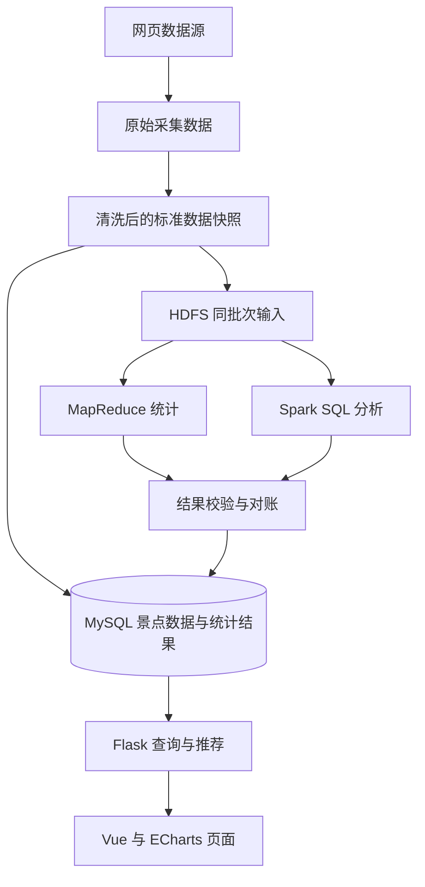

# 系统架构与模块边界

- 文档状态：已验收基线；实现与运行状态见 milestones.md。
- 需求依据：[项目要求](project.md)。
- 用途：统一系统的数据流、模块边界、代码目录和联调方式。

本文件定义已验收的架构方案，不代表相关程序已经实现。具体软件版本、部署平台与运行入口见 `docx/environment.md`；Hadoop/HDFS 与 MapReduce 的任务归属已同步到 `docx/roles.md`。

## 1. 维护规则与适用边界

本文件属于受保护的项目规范。**agent 修改、删除、重命名或移动本文件，必须事先获得人工对具体变更的明确批准。** 发现架构与实际实现不符时，应先说明差异与建议，不能通过改写本文件自行认可新的架构。

需求以 `docx/project.md` 为依据，本文件不代替需求定义；出现冲突时，按已有批准范围处理，需改变约定的部分先提交具体问题供人工决定。进度只在 `docx/milestones.md` 中维护，不在此记录每日任务。

## 2. 总体方案

项目采用同一个 Git 仓库组织代码，包含离线数据处理与在线网页服务两条流程。离线流程负责采集、清洗、HDFS 存储和大数据分析；在线流程通过 Flask 读取 MySQL，完成景点查询、统计展示和偏好推荐。



图中标准数据与统计结果写入 MySQL，属于同一批次的数据准备过程；只有两者均导入并校验完成，才对网页提供该批次服务。

基本原则：

- HDFS、MapReduce 和 Spark SQL 处理真实项目数据，并保留可核查的运行结果。
- 网页请求读取已经准备好的数据，不在请求过程中启动爬虫、MapReduce 或 Spark 作业。
- MySQL 为在线查询与推荐提供数据；统计图表读取离线分析结果，页面负责交互与呈现。
- 推荐使用当前服务批次的景点数据，通过约定的规则匹配和排序；规则与权重尚未确定，不在架构中预填。
- 先用共同小样本跑通完整流程，再扩大采集范围。全国是基础覆盖目标，全球扩展依实际可行性开展。

## 3. 离线数据处理流程

| 阶段 | 输入与处理 | 必须交付的结果 |
| --- | --- | --- |
| 1. 来源验证与采集 | A 自主选择主要及备用来源，验证可访问范围与字段，运行爬虫。 | 原始数据、来源记录、采集时间和失败记录。 |
| 2. 清洗与标准化 | 对原始数据去重、整理地区与等级、标记价格和类型的缺失情况。 | 标准 CSV、清洗数量与质量说明、批次记录。 |
| 3. HDFS 数据准备 | 将选定的标准快照上传到对应批次的 HDFS 输入目录。 | 可读取的 HDFS 输入及其对应的本地标准快照。 |
| 4. MapReduce 统计 | 从 HDFS 读取该快照，统计城市景点数量与等级分布。 | HDFS 输出、运行记录和可检查的统计结果。 |
| 5. Spark SQL 分析 | 读取同一批 HDFS 标准输入，执行数量、等级、有效价格与质量分析。 | 统计结果、运行记录和分析结论依据。 |
| 6. 校验与导入 | 核对样本及两个框架重叠的统计，将标准景点数据和通过校验的结果导入 MySQL。 | 与选定批次一致的在线数据、导入与核对记录。 |
| 7. 网页验收 | 启动接口和页面，检查查询、图表、推荐及数据说明。 | 可动态访问的网页和完整流程的验证记录。 |

最小流程可以按上述顺序执行，不要求实现自动任务调度。MapReduce 与 Spark SQL 是独立的计算环节，Spark 不需要依赖 MapReduce 输出作为输入；两者共享标准快照，以便对账。

重叠统计在对账通过后，按数据契约确定的来源发布一份展示结果；另一个框架的结果保留作核对依据。不能把两个框架对同一批景点计算出的相同指标相加，造成重复统计。

Pandas 用于清洗、整理输入和独立核对小样本，不代替项目要求的 MapReduce 与 Spark SQL 分析。HDFS 和本地文件系统应明确区分，不能将本地目录命名为 HDFS 后声称已完成 HDFS 使用。

## 4. 计划代码目录

以下是规划的逻辑目录。**规范与配置模板已经建立；业务目录、脚本和服务是否可用，仍须核对实际产物与验证，不能将目录规划当作现成程序或可执行命令。** 实现时按模块需要创建，不为填满目录树生成空文件。

```text
tourism-analysis-recommender/
├── README.md                  # 项目介绍与阅读导航
├── AGENTS.md                  # agent 共同规则与阅读入口
├── CLAUDE.md                  # 仅导入 AGENTS.md
├── docx/                      # 专项规范文档
├── crawler/                   # 爬虫与各来源的解析逻辑
├── processing/                # 清洗、标准导出与 MySQL 导入
├── analysis/
│   ├── mapreduce/             # MapReduce 源码与作业入口
│   └── spark/                 # Spark SQL 程序与分析输出逻辑
├── backend/
│   └── app/
│       ├── routes/            # HTTP 参数处理与响应组织
│       ├── repositories/      # MySQL 查询与候选景点读取
│       └── services/          # 推荐匹配、排序与理由生成
├── frontend/                  # Vue 页面、ECharts 与接口调用
├── database/                  # 数据库结构和初始化 SQL
├── data/
│   ├── raw/                   # 原始采集结果，按批次保存
│   ├── processed/             # 清洗后的标准快照
│   ├── results/               # 计算结果、对账与运行记录
│   ├── metadata/              # 来源登记、批次与质量记录
│   └── samples/               # 适合共享的共同样本
├── scripts/                   # 模块运行、导入和检查的辅助入口
├── tests/                     # 有必要的模块检查与集成验证
├── .env.example               # 环境变量名称及非敏感示例
├── .gitignore                 # 数据、环境与生成文件的提交边界
└── .github/                   # PR 模板与后续确定的仓库配置
```

目录边界说明：

- `crawler/` 只处理来源采集与解析；清洗、标准导出和数据库导入集中在 `processing/`，避免每个爬虫各自维护一套标准。
- `analysis/` 保存实际计算源码。每批输出放在 `data/results/` 及相应 HDFS 输出目录，不混入源码目录。
- `backend/app/repositories/` 封装在线数据查询；`processing/` 负责离线写入，不在 HTTP 请求中重新导入数据。
- `backend/app/services/` 中的推荐逻辑提供可调用函数，避免与 Flask 请求对象、页面代码耦合。
- `database/` 中的 SQL 实现数据契约约定的结构，不另建一套含义不同的字段。
- `scripts/` 只组织必要的运行步骤，业务逻辑仍留在所属模块。HDFS 操作辅助入口放在此处，具体入口与责任按分工及环境规范执行。
- 依赖文件、锁文件和具体启动入口，随统一环境方案确定；当前不指定未经验证的文件名与命令。

## 5. 模块输入输出与边界

| 模块 | 对外提供 | 边界 |
| --- | --- | --- |
| 采集 | 原始记录、来源与采集记录。 | 不自行改变共享字段含义，不用生成数据替代真实采集成果。 |
| 清洗与导入 | 标准快照、质量记录、数据库导入能力。 | 相同来源批次的处理应可重复，不在重跑时无提示地累加重复景点。 |
| MapReduce | 城市数量与等级分布结果。 | 读取约定的 HDFS 标准输入，不单独采用另一套去重、城市或等级规则。 |
| Spark SQL | 多维统计结果与分析依据。 | 使用与 MapReduce 一致的批次与统计口径，价格分析注明有效样本。 |
| 数据查询 | 景点列表、详情、筛选候选、统计结果与数据说明的读取能力。 | 查询集中在 repositories，页面和推荐函数不各自编写数据库连接逻辑。 |
| 推荐 | 对候选景点按偏好匹配、排序并给出理由。 | 不直接操作 HTTP 响应或访问网页；具体规则以实际数据与后续算法说明为准。 |
| Flask 接口 | 对外提供查询、统计、推荐和数据说明。 | 在入口校验参数、协调查询与推荐、组织响应，不在路由中复制算法实现。 |
| Vue/ECharts | 页面交互、列表与图表呈现。 | 从约定接口获取业务数据；可转换展示格式，不在页面重新定义分析统计口径。 |

模块的具体负责人、共享目录修改方式和交付要求见 `docx/roles.md`。A 自主选择和验证数据源，并负责 Hadoop/HDFS/YARN 与上传；B 负责 MapReduce/Spark 作业；C 负责网页运行部署。环境细节按 `docx/environment.md` 执行。

## 6. 数据批次、存储与一致性

### 6.1 三类存储的作用

| 位置 | 作用 | 使用方式 |
| --- | --- | --- |
| 本地数据目录 | 保留原始记录、标准快照、样本和核对依据。 | 支持重新处理与排查，是否提交到 Git 取决于后续分发约定。 |
| HDFS | 保存大数据作业的标准输入和计算输出。 | MapReduce 与 Spark SQL 读取同一批标准输入；各自输出分开保存。 |
| MySQL | 保存当前网页服务的标准景点与已校验统计结果。 | Flask 查询和推荐使用的数据来源，不承担每次访问时重新计算大数据统计的工作。 |

HDFS 路径前缀、数据库名、表结构和具体文件格式不在此重复定义，分别由环境文档与数据契约确定。

### 6.2 同一快照贯穿全流程

- 每次选定用于分析和演示的标准数据都应有可追溯的批次标识；其字段名和编码方式由数据契约定义。
- 批次记录应能对应原始来源、采集时间、清洗规则、标准输入、HDFS 输入输出、分析结果和 MySQL 导入结果。
- 记录来源资料时间与实际采集时间，落实截至 2026 年 10 月的数据时间口径；时间缺失应说明，不能补造历史快照。
- 标准快照发布给计算模块后保持固定。修复清洗或补充来源产生新的快照时，使用新的批次记录，并重新完成相应计算与导入。
- 不能只更新数据库景点数量而继续展示旧统计，也不能在另一批数据上复用旧推荐结果。

### 6.3 更新与失败处理

最小版本采用离线批次更新。更新在线数据库时暂停接口服务，导入并核对选定批次的景点与统计数据，校验通过后再启动服务。具体入口及恢复要求见环境文档。

- 计算结果写入各自批次的输出位置，避免重跑时误覆盖其他批次。需要清理时先核对实际路径，不能为运行样例而删除其他成员的数据。
- 运行失败应保留阶段、输入输出位置和错误记录，不把失败或缺失输出当作空统计发布。
- 对账失败先排查批次、去重、缺失值和行政区口径，不通过修改某一边的结果强行凑齐。
- 导入或校验失败时保持服务暂停，恢复已验证的数据后再启动；更新前保留上一批有效数据的可恢复材料，不能依赖重新爬取才能恢复。
- 服务无可用数据或依赖不可用时返回明确状态，前端展示空状态或错误反馈，不能以固定演示数值掩盖失败。

## 7. 在线调用流程

### 7.1 景点查询与分析展示

```text
用户操作 → Vue 发起请求 → Flask 校验参数
         → repositories 查询 MySQL → Flask 返回约定结果 → Vue/ECharts 展示
```

查询支持需求规定的搜索与筛选。地图、城市数量榜和统计图读取同一批次的分析结果，页面应能展示实际覆盖范围、数据更新时间和必要的缺失说明。具体接口路径、分页方式、错误码及字段由 `docx/api-contract.md` 统一定义。

地图先使用省份或城市汇总数据。行政区名称或代码与地图资源的匹配规则由数据契约落实，无法匹配的记录应计入说明，不能静默丢弃。地图底图是展示资源，其来源和使用条件单独记录，不能当作已采集景点数据的证据。

### 7.2 偏好推荐

```text
用户偏好 → Flask 校验 → repositories 读取符合约束的候选景点
         → services 中的推荐函数匹配、排序并生成理由
         → Flask 组织结果 → 推荐页面展示
```

- 数据查询模块负责读取候选，推荐模块负责匹配和排序，接口模块负责参数与响应；三者通过约定的输入输出衔接。
- 推荐候选取自用户条件对应的数据范围，不能只对列表页面当前显示的一页景点计算后声称完成全范围推荐。
- 数据库筛选与推荐函数对预算、地区和类型采用相同口径，不在不同层分别定义免费、未知价格或景点类别。
- 保留需求中的预算边界：预算为单个景点门票上限，未知或不可比价格不得宣称符合已选预算，无结果时不静默放宽条件。
- 排序规则、权重与验证样例目前待定，不能从目录规划推断算法已经确定。相同数据与规则应支持结果复查，理由应能对应实际匹配依据。
- 若扩展全球数据，跨币种或不同等级体系的比较需要先确定统一口径；不能直接比较不同币种的价格数值或把中国 A 级体系套到所有景点。

最小版本按用户当次输入工作，不引入注册登录或持久化用户行为记录。

## 8. 配置、共享数据与联调

- 数据库连接、HDFS 地址和其他环境差异通过统一配置传入，不将成员电脑的绝对路径、密码或令牌写入共享源码。变量名称和实际读取方式由环境文档统一。
- `.env.example` 只包含可公开示例，真实环境配置留在成员本机；文件提交范围由 Git 规范落实。
- 原始数据、全量快照和运行结果不因放进 `data/` 就自动获得公开分发许可。可共享样本、地图资源和第三方数据分别确认分发方式。
- 共同样本放在 `data/samples/`，与全量数据使用相同契约；真实来源样本与专门构造的测试记录应明确区分。
- A 提供可调用的查询能力，B 提供可调用的推荐能力及统计结果，C 负责接入接口与页面；详细代码归属与交接事项见分工文档。

首次联调按以下顺序推进：

1. 确定共同样本及数据、接口契约，三人可以围绕同一输入独立开发。
2. 样本经过清洗、HDFS、MapReduce、Spark SQL、核对和数据库导入，保留全流程记录。
3. 跑通一次网页查询、一次统计展示和一次偏好推荐，再扩大数据量与完善页面。
4. 检查重复景点、未知价格、地区无法匹配、推荐无结果和数据批次不一致等边界；依赖失败时有清楚反馈。

单模块检查可以使用明确标记的测试数据，但系统验收需要经过真实样本与完整数据流程。当前阶段只编写架构文档，不创建上述程序、样本或运行证据。

## 9. 配套文档的唯一职责

| 文档 | 负责定义的内容 |
| --- | --- |
| `docx/project.md` | 功能范围、必用技术与验收标准。 |
| `docx/architecture.md` | 数据流、模块调用、目录与一致性边界。 |
| `docx/roles.md` | 成员职责、代码所有权、交付与交接。 |
| `docx/data-contract.md` | 字段、单位、空值、主键、数据格式、数据库结构与统计口径。 |
| `docx/api-contract.md` | 模块调用输入输出与 HTTP 请求、响应、分页和错误约定。 |
| `docx/environment.md` | 统一版本、部署平台、路径生成、安装启动入口，以及已确认的 Hadoop/MapReduce 任务归属。 |
| `docx/git-workflow.md` | 分支、提交、PR、审查与文件提交边界。 |
| `docx/milestones.md` | 进度、阻塞项与下一阶段任务，不改变冻结的规范。 |
| `docx/decisions.md` | 已批准的重要取舍、依据及尚待决策的问题。 |

本文件不复制数据契约、接口契约和环境规范中的字段表、接口格式或版本清单。配套规范已建立；遇到尚缺的实现或执行约定时，先明确依赖，不能把规划路径当作已有程序，或自行改写受保护文档补齐。

## 10. 架构验收与尚待确定事项

架构方案验收时应能确认：

- 从采集到网页的每个环节都有明确输入、输出与模块位置。
- HDFS、MapReduce、Spark SQL 均有实际作用，网页请求与离线作业有清楚边界。
- 同一批次的标准数据、统计与推荐可以核对，失败结果不会被当作有效结果展示。
- 查询、推荐和 HTTP 组织分开，三名成员能够通过契约交付模块。
- 全国范围和截至 2026 年 10 月的要求得到保留，全球扩展不阻塞基础交付。
- 目录规划没有被误称为已实现的代码，未定项没有被擅自固化为承诺。

共享字段、接口、软件基线、部署方案及 Hadoop/MapReduce 任务归属已由专项规范确定，实际实现与运行仍须验证。待实践事项包括 A 自主验证具体来源、真实价格政策与类型整理、推荐最终排序；项目日期和代码、数据的具体公开分发方案仍未确定。
